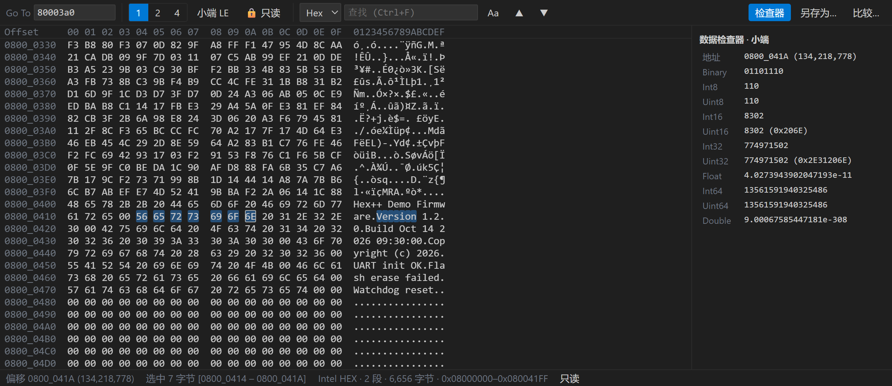
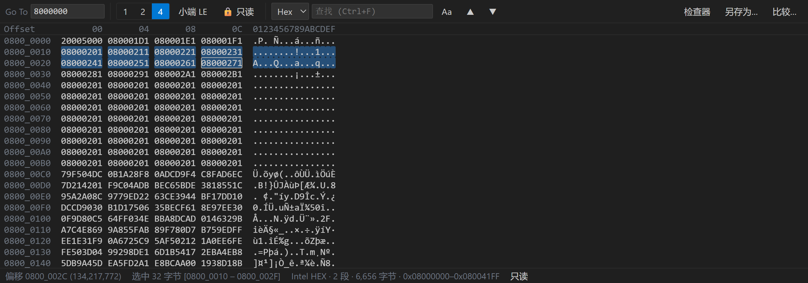
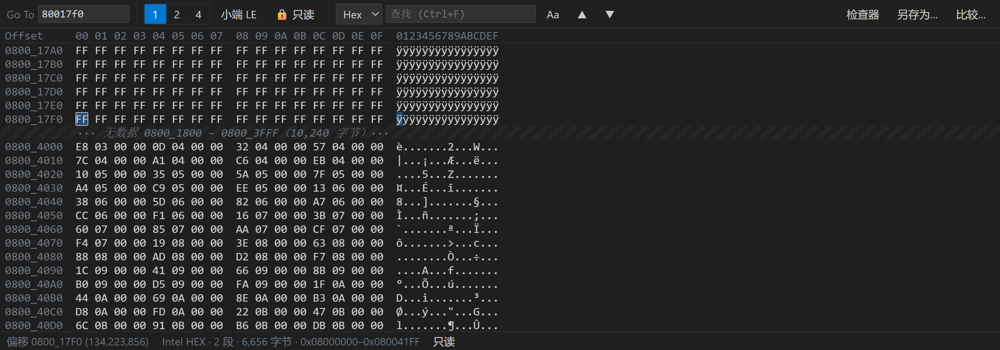
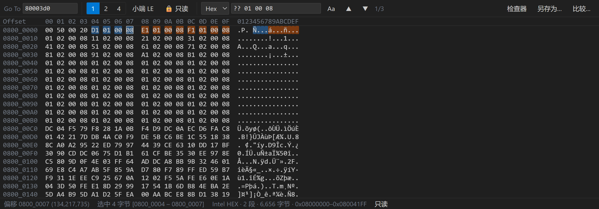
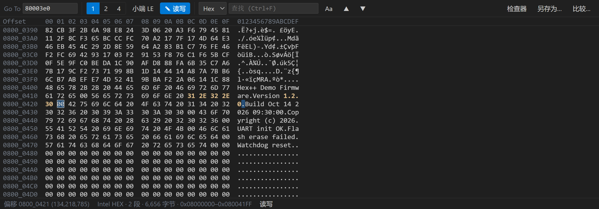
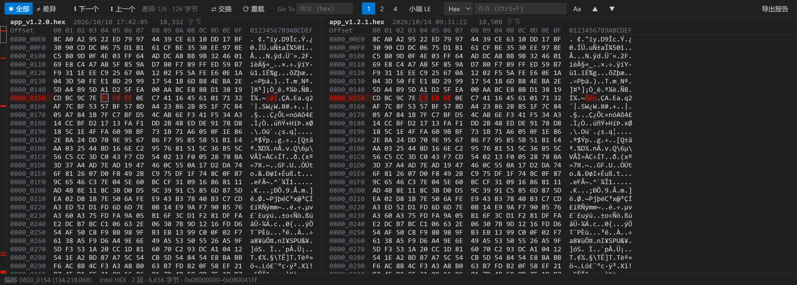
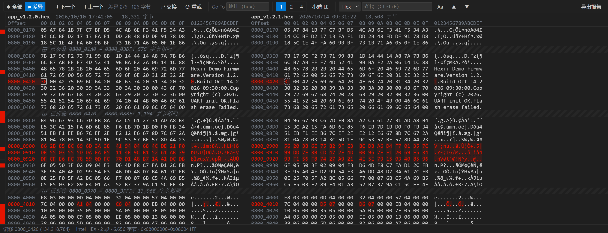
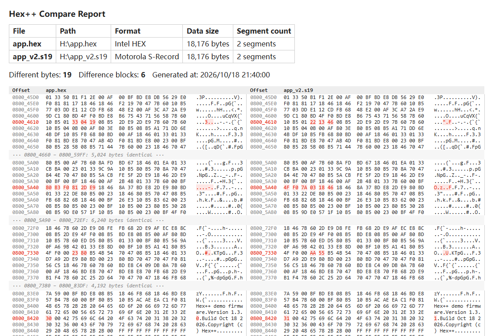

# Hex++

**面向嵌入式与固件开发的 VS Code 十六进制查看 / 编辑 / 对比工具。** 直接打开 Intel HEX、S-Record、TI-TXT、ELF、BIN 固件，按真实地址显示；两个不同格式的固件也能逐字节对比。

*A hex viewer, editor and diff tool for VS Code, built for firmware: open Intel HEX / S-Record / TI-TXT / ELF / BIN files at their real addresses, edit them, convert between formats, and compare two images byte by byte. The UI is in Chinese.*



## 功能一览

- 📂 **固件格式**：BIN、Intel HEX、S-Record、TI-TXT、ELF，按文件中的真实地址显示，地址空洞一目了然
- 🔢 **1 / 2 / 4 字节单元**显示，可切换大小端；**数据检查器**同步显示 Int8–64、Float、Double 等数值
- 🎯 **跳转与查找**：十六进制 / 十进制 / 相对地址跳转；Hex（支持通配符）、文本、正则查找
- ✏️ **编辑**：覆盖写入、撤销 / 重做、填充选区，保存时保持原格式
- 📋 **复制为**：C / Go / Java 数组、JSON、Base64、Intel HEX 等 13 种格式，带预览
- 🔄 **格式互转**：BIN、Intel HEX、S-Record、TI-TXT 任意互转
- 🧮 **校验**：16 种 CRC 预设（含 STM32 硬件 CRC）与自定义 CRC、Sum8/16/32、MD5 / SHA-1 / SHA-256，随选区实时计算
- 🩹 **补丁**：把 CRC、版本号、时间戳、序列号写进固件，一次应用、一次撤销
- 🏭 **固件加工**：合并 Bootloader + App、偏移、裁剪、填充、对齐、写入 CRC、拆分，修改即时预览，方案可导出复用
- ⚖️ **对比**：不同格式也能按地址对比，只看差异、一键跳到下一个差异，可导出 HTML 报告

## 目录

- [打开文件](#打开文件)
- [浏览与导航](#浏览与导航)
- [查找](#查找)
- [数据检查器](#数据检查器)
- [编辑](#编辑)
- [复制](#复制)
- [另存为 / 格式互转](#另存为--格式互转)
- [校验和 / CRC / 哈希](#校验和--crc--哈希)
- [写入补丁](#写入补丁)
- [固件加工](#固件加工)
- [对比两个文件](#对比两个文件)
- [快捷键](#快捷键)
- [设置](#设置)
- [支持的格式](#支持的格式)
- [常见问题](#常见问题)

## 打开文件

Hex++ 提供两种打开方式：

| 编辑器 | 说明 |
| --- | --- |
| **Hex++ Editor** | 可编辑（默认以只读模式打开，按 `Insert` 切换为读写） |
| **Hex++ Viewer (read-only)** | 纯只读查看 |

打开方法：

1. 在资源管理器中右键文件，选择 **用 Hex++ 打开**（Open in Hex++）。
2. 对已经打开的文件：点击编辑器标签右键或命令面板 → **重新打开编辑器的方式…**（Reopen Editor With…）→ 选择 Hex++。
3. 命令面板（`Ctrl+Shift+P`）→ **Hex++: 用 Hex++ 打开**。

> 💡 **默认打开方式**：`.bin` `.hex` `.ihex` `.ihx` `.srec` `.s19` `.s28` `.s37` `.mot` `.elf` 双击即用 Hex++ 编辑器打开（`.txt` 不在其中，TI-TXT 需手动选择）。
> 其他扩展名或想改为只读查看，可在 `settings.json` 中覆盖：
>
> ```json
> "workbench.editorAssociations": {
>   "*.txt": "HexPlusPlus.hexEdit",
>   "*.bin": "HexPlusPlus.view",
>   "*.hex": "default"
> }
> ```
>
> `"default"` 表示改回 VS Code 自带的文本编辑器。

界面组成：

- **工具栏**：跳转框、1 / 2 / 4 字节单元、字节序、只读 / 读写、查找框、检查器、另存为、比较。
- **网格**：左边为地址（`0800_0000` 格式），中间为十六进制，右边为 ASCII。
- **状态栏**：光标偏移、选区范围与字节数、文件格式、段数、数据大小、地址范围；文件有解析警告时显示 `⚠ N 个解析警告`，点击可查看详情。

## 浏览与导航

### 字节单元与字节序

点击工具栏的 `1` `2` `4`（或按 `Ctrl+1` / `Ctrl+2` / `Ctrl+4`）按 1、2、4 字节为一组显示；点击 `小端 LE` / `大端 BE` 切换字节序。字节序同时影响 2 / 4 字节单元的显示、数据检查器和鼠标悬停提示。



### 地址空洞

带地址的格式（HEX、S-Record、ELF 等）中，没有数据的地址区间会折叠成一行 `··· 无数据 …（N 字节）···`，不必滚过大片空白区域。



### 跳转

按 `Ctrl+G`（或点击工具栏的 **Go To** 输入框），输入地址后回车：

| 输入 | 含义 |
| --- | --- |
| `0800_1000`、`08001000`、`0x1000`、`1000h` | 十六进制地址（`_` 会被忽略） |
| `#4096` | 十进制地址 |
| `+10`、`-0x20`、`+#16` | 相对当前光标偏移 |

右键菜单的 **选择两个偏移量之间的数据…** 可以按起止地址精确选中一段数据。

### 鼠标与键盘

- 单击定位光标，拖动或 `Shift+单击` 选择范围。
- 方向键移动光标，`Shift+方向键` 扩展选区；`PageUp` / `PageDown` 翻页。
- `Home` / `End` 移到行首 / 行尾，`Ctrl+Home` / `Ctrl+End` 移到数据开头 / 结尾。
- `Ctrl+A` 全选，`Esc` 取消选区，`Tab` 在十六进制区和 ASCII 区之间切换。
- 鼠标悬停在字节上会显示该位置作为 u8 / u16 / u32 的值。

## 查找

按 `Ctrl+F` 聚焦查找框，左侧下拉框选择查找方式：

| 方式 | 示例 | 说明 |
| --- | --- | --- |
| **Hex** | `DE AD BE EF`、`?? 01 00 08`、`DEADBEEF` | `*` 或 `??` 匹配任意一个字节 |
| **文本** | `Version` | 按字节匹配 ASCII / Latin-1 文本 |
| **正则** | `V\d+\.\d+` | JavaScript 正则表达式 |

- 边输入边查找，大文件中的结果会流式显示，所有命中处高亮。
- `Enter` / `Shift+Enter`（或 ▼ / ▲ 按钮）跳到下一个 / 上一个结果，工具栏显示 `当前/总数`。
- `Aa` 按钮切换是否区分大小写（文本、正则方式）。



## 数据检查器

点击工具栏的 **检查器** 打开右侧面板，显示光标处数据按当前字节序解析后的值：Binary、Int8 / Uint8、Int16 / Uint16、Int32 / Uint32、Float、Int64 / Uint64、Double。面板里的数值可以直接选中复制。

（截图见页首）

## 编辑

1. 在 **Hex++ Editor** 中按 `Insert`（或点击工具栏的 `🔒 只读`）切换为 `✎ 读写`。
2. 在十六进制区直接输入 `0-9` `A-F` 改写字节；按 `Tab` 切到 ASCII 区可以直接输入字符（需要 1 字节单元）。
3. 已修改的字节以高亮加粗显示，保存后恢复正常颜色。
4. `Ctrl+Z` / `Ctrl+Y` 撤销 / 重做，`Ctrl+S` 按**原格式**保存（HEX 仍保存为 HEX，ELF 原位回写）。



其他编辑能力：

- **填充选区**（`Ctrl+I` 或右键菜单）：输入字节序列，如 `FF` 或 `DE AD BE EF`，按顺序循环填满选区。
- **热退出**：未保存的修改在关闭 VS Code 后会被保留，下次打开时恢复。
- **外部修改检测**：文件被其他程序改写时，如果没有未保存的修改会自动重新加载；如果有，会询问是否放弃修改并重新加载。

> ⚠️ Hex++ 只能**覆盖**已有字节，不能插入或删除字节，也不能在地址空洞处写入。这样可以保证固件中所有数据的地址不变。

## 复制

| 操作 | 说明 |
| --- | --- |
| `Ctrl+C` | 按当前显示的样子复制（随 1 / 2 / 4 字节单元和字节序变化），默认格式可在设置中修改 |
| `Ctrl+Alt+C` 复制为… | 弹出格式列表，每项下方显示预览，上次用过的格式排在第一位 |
| 右键 → 复制偏移量 | 复制光标地址，十六进制（`0x08000400`）或十进制 |

“复制为”支持的格式（以 `00 01 02 FF` 为例）：

| 格式 | 输出 |
| --- | --- |
| Hex Octets | `00 01 02 FF` |
| Hex | `000102FF` |
| Literal | `\x00\x01\x02\xff` |
| C | `unsigned char data[4] = { 0x00, 0x01, 0x02, 0xFF };` |
| Go | `var data = []byte{0x00, 0x01, 0x02, 0xFF}` |
| Java | `byte data[] = { 0x00, 0x01, 0x02, (byte) 0xFF };` |
| JSON | `[0, 1, 2, 255]` |
| Base64 | `AAEC/w==` |
| UTF-8 | 按 UTF-8 解码的原始文本 |
| Intel HEX / S-Record / TI-TXT | 带选区真实地址的记录，可直接粘贴为一个小固件 |

C / Go / Java 数组的变量名取自文件名。

## 另存为 / 格式互转

点击工具栏的 **另存为…**，或在资源管理器中右键文件 → **另存为 / 转换格式…**：

1. 选择目标格式：Binary、Intel HEX、Motorola S-Record、TI-TXT（源文件是 ELF 时还可以选 ELF）。
2. **BIN → 带地址格式**：BIN 文件不含地址信息，会询问起始地址，例如 `0x08000000`。
3. **带地址格式 → BIN**：BIN 从第一个数据段的地址开始（该地址对应文件偏移 0），地址空洞用填充字节（默认 `0xFF`，可在设置中修改）补齐，完成后会提示起始地址和填充了几处空洞。
4. 选择保存位置后，可以直接用 Hex++ 打开结果文件。

从编辑器中另存时，**会包含尚未保存的修改**。

## 校验和 / CRC / 哈希

点击工具栏的 **校验**（或右键 → **校验和 / CRC / 哈希**），右侧面板显示计算结果：

- **范围**：`选区`（没有选区时按全部计算）/ `全部` / `自定义`。自定义的结束地址包含在内，也可以写 `+长度`，如 `+8000`（十六进制，`+#4096` 为十进制）。
- **空洞**：`填充` 时按填充字节参与计算（与 `srec_cat -fill` 一致），`跳过` 时只算有数据的字节。
- **算法**：点 **算法 ▾** 勾选要显示的算法，选择会被记住。
  - CRC：CRC-8、CRC-8/MAXIM、CRC-8/SAE-J1850、CRC-8/AUTOSAR、CRC-16/CCITT-FALSE、CRC-16/XMODEM、CRC-16/KERMIT、CRC-16/MODBUS、CRC-16/ARC、CRC-16/USB、CRC-32、CRC-32/MPEG-2、CRC-32/STM32、CRC-32C、CRC-32/BZIP2、CRC-32/AUTOSAR，以及**自定义 CRC**（宽度、多项式、初值、结果异或、输入 / 输出反转）
  - 校验和：Sum8、Sum8 补码、XOR8、Sum16、Sum32、16 / 32 位字之和（随字节序）
  - 哈希：MD5、SHA-1、SHA-256
- **CRC-32/STM32** 对应 STM32 硬件 CRC 外设的默认配置：按小端 32 位字从内存取数，结果与 `HAL_CRC_Calculate` 一致。

点击结果即可复制；点 **写入…** 会以该算法和范围新建一个补丁。对比视图中也可计算当前一侧的校验。

## 写入补丁

点击工具栏的 **补丁**，把计算出的值写回固件：

| 类型 | 说明 |
| --- | --- |
| 校验值 | 对指定范围计算 CRC / 校验和 / 哈希后写入，数值型可选字节序 |
| 数值 | u8 / u16 / u32 常量，十进制或 `0x` 十六进制，负数按补码 |
| 序列号 | 同数值，每次应用成功后按步长自动递增 |
| 时间戳 | Unix 秒（u32）、BCD（`YYYYMMDDhhmmss`，7 字节）或文本模板（如 `YYYY-MM-DD hh:mm:ss`） |
| 文本 | UTF-8 字符串，可设固定长度（不足补 `00`） |
| 字节序列 | 任意十六进制字节，如 `DE AD BE EF` |

- 每个补丁下方实时显示将写入的地址和字节；地址有误、落在空洞中或数值越界时直接标红。
- 补丁**按列表顺序**写入，后面的校验值能算进前面写入的版本号等数据。如果校验值补丁之后的补丁又改了校验范围内的数据，会给出提示。
- **应用补丁**（`Ctrl+Enter`）一次写入全部启用的补丁，`Ctrl+Z` 一次撤销；只读模式下会先询问是否切换为读写。
- 补丁方案按文件自动保存，可 **导出 / 导入** 为 JSON，与同事共享。

## 固件加工

在资源管理器中选中一个或多个文件右键 → **固件加工…**，或点编辑器工具栏的 **加工…**（会带上未保存的修改），打开加工面板：

1. **输入文件**：可添加多个文件，按地址合并（如 Bootloader + App）。每个文件可设偏移；BIN 文件的偏移就是加载地址。地址重叠时可选择报错、后者覆盖或前者优先。
2. **处理步骤**：按顺序执行，可停用、调整顺序。
   - 地址偏移、移动到地址、裁剪（保留范围）、删除范围
   - 填充：只填空洞或覆盖整个范围
   - 段对齐：段首尾扩展到 N 字节边界（如扇区大小）
   - 写入补丁：与上面的补丁相同，如在末尾写入 CRC-32
3. **结果预览**：地址分布图（大段空洞会被压缩显示）、段列表、总大小与 CRC-32，任何修改都即时刷新。
4. **输出**：Intel HEX / S-Record / TI-TXT / BIN；可不拆分、每段一个文件、按大小（按扇区边界对齐）或按地址拆分。

**导出方案** 会把输入、步骤和输出设置保存为 `.hexpp.json`（路径相对方案文件），之后 **导入方案** 即可一键重做，适合纳入版本管理。

## 对比两个文件

### 打开对比

- 在资源管理器中**选中两个文件** → 右键 → **比较所选文件 (Hex++)**。
- 右键单个文件 → **与...比较 (Hex++)**，再选择另一个文件。
- 在 Hex++ 编辑器中点击工具栏的 **比较…**。
- 命令面板 → **Hex++: 比较两个文件...**。

两个文件可以是**不同格式**，例如 `.hex` 与 `.elf`、`.s19` 与 `.bin`。Hex++ 会按地址逐字节比较：值不同、或一侧有数据另一侧是空洞，都算作差异。



### 对比视图

- 每侧顶部显示文件名、修改时间和文件大小，差异字节标红，差异所在行的地址也标红。
- 左侧**概览条**用红色标出所有差异的位置，点击或拖动可以快速跳转。
- **✱ 全部 / ≠ 差异**：“差异”视图只保留每处差异前后 64 字节，相同的大片区域（≥ 256 字节）折叠成一行 `⊞ 已折叠 … 字节相同`，点击折叠行即可展开到该位置。
- **⬇ 下一个**（`F8`）/ **⬆ 上一个**（`Shift+F8`）：逐个浏览差异块，工具栏显示 `差异 当前/总数 · 差异字节数`。
- **⇄ 交换**左右两侧，**⟳ 重载**（`F5`）重新读取磁盘上的文件。
- 跳转、查找、1 / 2 / 4 字节单元、复制等功能与单文件视图相同。



### 导出 HTML 报告

点击 **导出报告**，生成一个独立的 HTML 文件，包含两个文件的信息、差异统计，以及每处差异附近的数据（相同区域自动折叠），方便存档或发给同事。



## 快捷键

| 快捷键 | 功能 | 适用 |
| --- | --- | --- |
| `Ctrl+G` | 跳转到地址 | 编辑器 / 对比 |
| `Ctrl+F` | 查找 | 编辑器 / 对比 |
| `Ctrl+1` / `Ctrl+2` / `Ctrl+4` | 按 1 / 2 / 4 字节显示 | 编辑器 / 对比 |
| `Ctrl+C` | 复制 | 编辑器 / 对比 |
| `Ctrl+Alt+C` | 复制为… | 编辑器 |
| `Insert` | 切换只读 / 读写 | 编辑器 |
| `Ctrl+I` | 填充选区 | 编辑器（读写） |
| `Ctrl+Enter` | 应用补丁（焦点在补丁面板时） | 编辑器 |
| `Ctrl+Z` / `Ctrl+Y` / `Ctrl+S` | 撤销 / 重做 / 保存 | 编辑器 |
| `F8` / `Shift+F8` | 下一个 / 上一个差异 | 对比 |
| `F5` | 重新加载 | 对比 |

macOS 上将 `Ctrl` 换成 `Cmd`。

## 设置

| 设置项 | 默认值 | 说明 |
| --- | --- | --- |
| `HexPlusPlus.defaultUnit` | `1` | 默认显示单元（1、2 或 4 字节） |
| `HexPlusPlus.littleEndian` | `true` | 2 / 4 字节单元与数据检查器按小端解释 |
| `HexPlusPlus.readOnlyByDefault` | `true` | Hex++ Editor 打开时默认只读（`Insert` 切换） |
| `HexPlusPlus.copy.defaultFormat` | `displayed` | `Ctrl+C` 使用的格式；`displayed` 表示按当前显示复制，也可设为 `hex`、`c`、`base64`、`ihex` 等 |
| `HexPlusPlus.export.fillByte` | `255`（`0xFF`） | 导出 BIN 时用于填充地址空洞的字节 |
| `HexPlusPlus.export.recordLength` | `16` | 导出 Intel HEX / S-Record / TI-TXT 时每条记录的数据字节数（16 或 32） |

## 支持的格式

| 格式 | 扩展名 | 说明 |
| --- | --- | --- |
| Intel HEX | `.hex` `.ihex` `.ihx` | 记录类型 00–05，检查校验和 |
| Motorola S-Record | `.srec` `.s19` `.s28` `.s37` `.mot` | S0–S9，检查校验和 |
| TI-TXT | `.txt` | `@` 地址行，`q` 结束 |
| ELF | 任意（按文件头识别） | 32 / 64 位、大小端；按物理地址加载 `PT_LOAD` 段 |
| BIN | 其他所有文件 | 从地址 0 开始 |

格式先按扩展名判断，再用文件内容确认；内容对不上时按 BIN 处理（例如内容不是 `@` 开头的 `.txt` 文件）。解析中遇到的错误（如校验和错误）不会中断加载，会在状态栏显示为警告。

## 常见问题

**为什么输入没有反应？**
Hex++ Editor 默认以只读模式打开，按 `Insert` 或点击工具栏的 `🔒 只读` 切换为读写。Hex++ Viewer 始终只读。

**对比结果里没有我刚做的修改？**
对比读取的是磁盘上的文件，不包含编辑器中尚未保存的修改。请先保存，再在对比视图中按 `F5` 重载。

**ELF 文件能另存为其他格式吗？**
可以把 ELF 的加载段导出为 BIN / HEX / S-Record / TI-TXT；但只能从 ELF 文件另存为 ELF，其他格式无法转换为 ELF。

**转换为 BIN 后文件变大了？**
BIN 没有地址信息，段与段之间的地址空洞必须用填充字节补齐。如果固件中的段相距很远（例如 Flash 与 EEPROM 两个区域），生成的 BIN 会很大。

**发现问题或有建议？**
欢迎到 [GitHub Issues](https://github.com/acerun/vsc_hex-/issues) 反馈。

## 许可证

[MIT](LICENSE)
