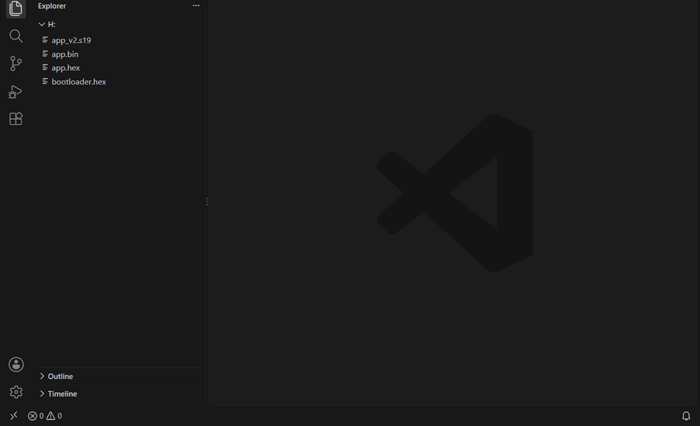
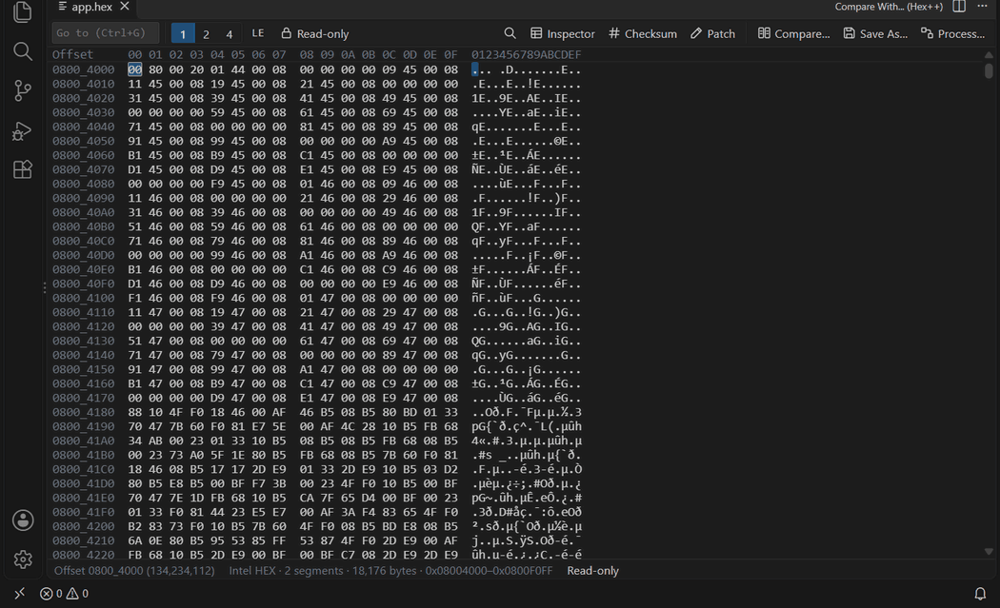
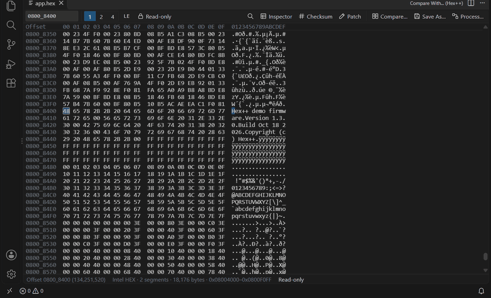
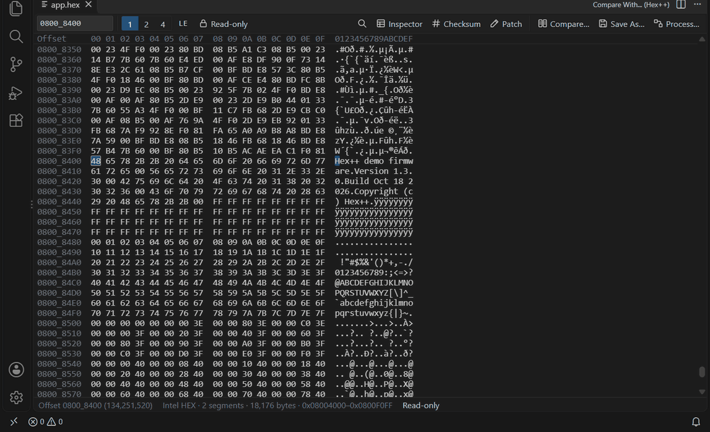
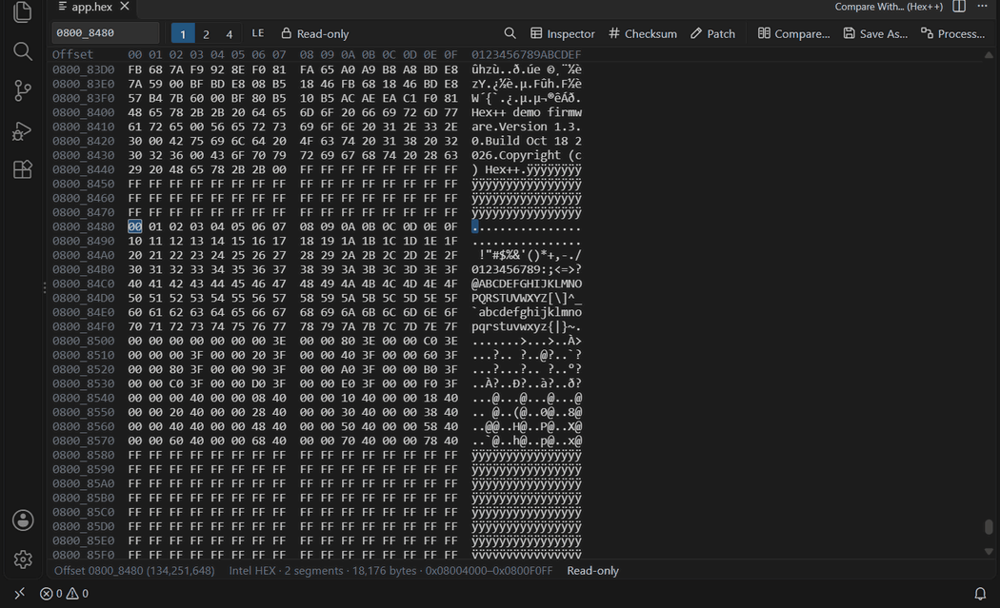
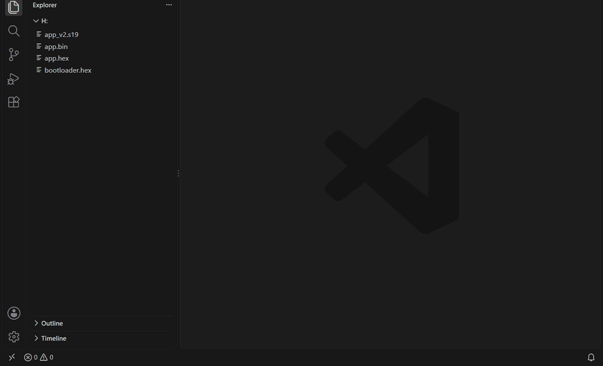
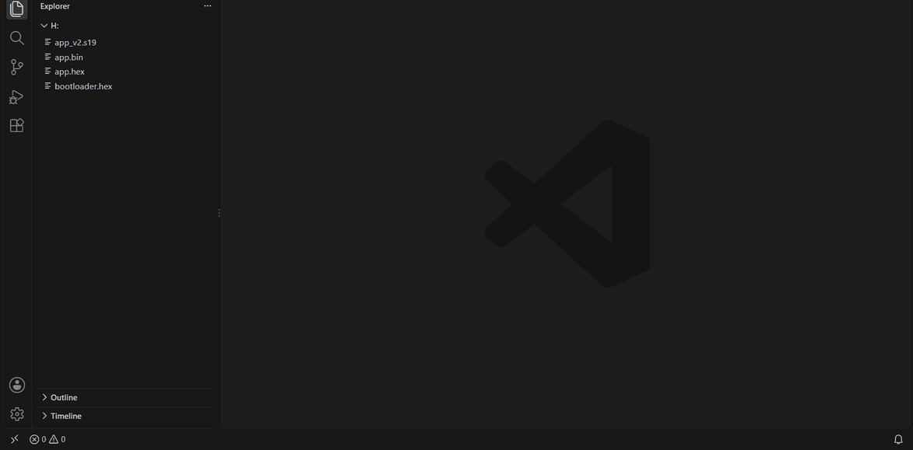

# Hex++

English | [简体中文](README.zh-CN.md)

**A hex viewer, editor and diff tool for VS Code, built for embedded and firmware development.** Open Intel HEX, S-Record, TI-TXT, ELF and BIN firmware at their real addresses. You can compute CRCs, patch version numbers, merge a bootloader with an app, and compare two firmware images in different formats without leaving the editor.



## Features

- 📂 **Firmware formats**: BIN, Intel HEX, S-Record, TI-TXT and ELF, shown at their real addresses. Address gaps fold into a single row. Firmware extensions open in Hex++ on double-click.
- 🔢 **1 / 2 / 4-byte units** with switchable endianness. The **Data Inspector** shows Int8–64, Float, Double and more.
- 🎯 **Go to and find**: hex, decimal or relative addresses. Hex search with wildcards, text search and regex search.
- ✏️ **Editing**: overwrite bytes, undo / redo and fill a selection. Files are saved in their original format.
- 📋 **Copy As**: 13 formats, including C / Go / Java arrays, JSON, Base64 and Intel HEX, each with a preview.
- 🔄 **Format conversion**: convert between BIN, Intel HEX, S-Record and TI-TXT in any direction.
- 🧮 **Checksums**: 16 CRC presets (including the STM32 hardware CRC), custom CRC, Sum8/16/32, MD5 / SHA-1 / SHA-256, recomputed live as the selection changes.
- 🩹 **Patches**: write CRCs, version numbers, timestamps and serial numbers into firmware in one step, and undo them in one step.
- 🏭 **Firmware processing**: merge bootloader + app, offset, crop, fill, align, write a CRC and split, with a live preview. Recipes can be exported and reused.
- ⚖️ **Compare**: compare files by address even when their formats differ. Show only the differences, jump between them and export an HTML report.
- 🌐 **English / 简体中文**: the UI follows the VS Code display language.

## Contents

- [Quick start](#quick-start)
- [Opening files](#opening-files)
- [Browsing and navigation](#browsing-and-navigation)
- [Find](#find)
- [Data Inspector](#data-inspector)
- [Editing](#editing)
- [Copying](#copying)
- [Save As / format conversion](#save-as--format-conversion)
- [Checksum / CRC / hash](#checksum--crc--hash)
- [Patches](#patches)
- [Firmware processing](#firmware-processing)
- [Comparing two files](#comparing-two-files)
- [Keyboard shortcuts](#keyboard-shortcuts)
- [Settings](#settings)
- [Supported formats](#supported-formats)
- [FAQ](#faq)

## Quick start

1. Search for **Hex++** in the Extensions view and install it.
2. Double-click a `.hex`, `.s19`, `.elf` or `.bin` file in the Explorer to open it in Hex++.
3. Press `Ctrl+G` to go to an address and `Ctrl+F` to find. **Inspector**, **Checksum** and **Patch** on the toolbar open the side panel.
4. Select two files in the Explorer, then right-click → **Compare Selected (Hex++)** to see the differences.

## Opening files

Hex++ provides two editors:

| Editor | Description |
| --- | --- |
| **Hex++ Editor** | Editable. Opens read-only by default; press `Insert` to switch to read/write. |
| **Hex++ Viewer (read-only)** | View only |

To open a file:

1. **Double-click** it. `.bin` `.hex` `.ihex` `.ihx` `.srec` `.s19` `.s28` `.s37` `.mot` `.elf` open in the Hex++ Editor by default. `.txt` is not included, so open TI-TXT files manually.
2. Right-click the file in the Explorer → **Open in Hex++**.
3. For a file that is already open, right-click its editor tab or use the Command Palette → **Reopen Editor With…** → choose Hex++.
4. Command Palette (`Ctrl+Shift+P`) → **Hex++: Open in Hex++**.

> 💡 To use Hex++ for other extensions, open a file read-only by default, or go back to the text editor, override the association in `settings.json`:
>
> ```json
> "workbench.editorAssociations": {
>   "*.txt": "HexPlusPlus.hexEdit",
>   "*.bin": "HexPlusPlus.view",
>   "*.hex": "default"
> }
> ```
>
> `"default"` means VS Code's built-in text editor.

Layout:

- **Toolbar**: a single row. On the left are the Go to box, the `1` `2` `4` byte units, endianness (`LE` / `BE`) and Read-only / Read/Write. On the right are Find, Inspector, Checksum, Patch, Compare…, Save As… and Process…. When the window is narrow, buttons show only their icons (hover for a tooltip). The toolbar wraps only when that is still too wide.
- **Grid**: addresses on the left (formatted as `0800_0000`), hex in the middle and ASCII on the right.
- **Side panel**: Inspector / Checksum / Patch tabs. Drag the panel's left edge to resize it.
- **Status bar**: cursor offset, selection range and size, file format, segment count, data size and address range. If the file has parse warnings, `⚠ N parse warnings` appears; click it for details.

## Browsing and navigation

### Byte units and endianness

Click `1` `2` `4` on the toolbar (or press `Ctrl+1` / `Ctrl+2` / `Ctrl+4`) to group bytes by 1, 2 or 4. Click `LE` / `BE` to switch between little-endian and big-endian. Endianness applies to the 2 / 4-byte display, the Data Inspector and the hover tooltip.

### Address gaps

In formats with addresses (HEX, S-Record, ELF and so on), address ranges with no data fold into a single row, `··· No data … (N bytes) ···`, so you don't have to scroll past large empty areas. The end of the overview animation at the top shows an example.

### Go to

Press `Ctrl+G` (or click the Go to box on the toolbar), type an address and press Enter:

| Input | Meaning |
| --- | --- |
| `0800_1000`, `08001000`, `0x1000`, `1000h` | Hex address (`_` is ignored) |
| `#4096` | Decimal address |
| `+10`, `-0x20`, `+#16` | Relative to the cursor |

To select an exact address range, right-click → **Select Between Offsets...**.

### Mouse and keyboard

- Click to place the cursor. Drag or `Shift+click` to select a range.
- Use the arrow keys to move the cursor and `Shift+arrow` to extend the selection. `PageUp` / `PageDown` move one page.
- `Home` / `End` go to the start / end of the row. `Ctrl+Home` / `Ctrl+End` go to the start / end of the data.
- `Ctrl+A` selects all, `Esc` clears the selection, and `Tab` switches between the hex and ASCII columns.
- Hovering over a byte shows its value as u8 / u16 / u32.

## Find

Press `Ctrl+F` (or click 🔍 on the toolbar) to open the floating find box in the top-right corner of the grid. Choose the mode from the drop-down on its left:

| Mode | Example | Notes |
| --- | --- | --- |
| **Hex** | `DE AD BE EF`, `?? 46 00 08`, `DEADBEEF` | `*` or `??` matches any single byte |
| **Text** | `Version` | Matches ASCII / Latin-1 text byte by byte |
| **Regex** | `\d+\.\d+\.\d+` | JavaScript regular expression |

- Results update as you type and stream in for large files. Every match is highlighted.
- `Enter` / `Shift+Enter` (or the ↓ / ↑ buttons) go to the next / previous match. The find box shows `current/total`.
- `Esc` closes the find box and clears the highlights.
- The `Aa` button toggles match case (Text and Regex modes).



## Data Inspector

Click **Inspector** on the toolbar to open the side panel. It shows the data at the cursor decoded with the current endianness: Binary, Int8 / Uint8, Int16 / Uint16, Int32 / Uint32, Float, Int64 / Uint64 and Double. You can select and copy any value. The overview animation at the top shows the inspector in use.

## Editing

1. In the **Hex++ Editor**, press `Insert` (or click the lock button labelled `Read-only` on the toolbar) to switch to `Read/Write`.
2. Type `0-9` `A-F` in the hex column to overwrite bytes. Click the ASCII column (or press `Tab`) to type characters there. ASCII input requires 1-byte units.
3. Modified bytes are highlighted in bold until you save.
4. `Ctrl+Z` / `Ctrl+Y` undo / redo. `Ctrl+S` saves in the **original format**: HEX stays HEX, and ELF is written back in place.



More editing features:

- **Fill Selection** (`Ctrl+I` or the context menu): enter a byte sequence such as `FF` or `DE AD BE EF`. It repeats to fill the selection.
- **Hot exit**: unsaved changes are kept when you close VS Code and restored the next time you open it.
- **External change detection**: if another program changes the file and you have no unsaved changes, Hex++ reloads it. If you do have unsaved changes, it asks whether to discard them and reload.

> ⚠️ Hex++ can only **overwrite** existing bytes. It cannot insert or delete bytes, or write into address gaps. This keeps every byte of the firmware at the same address.

## Copying

| Action | Description |
| --- | --- |
| `Ctrl+C` | Copies what is displayed, following the 1 / 2 / 4-byte unit and endianness. The default format can be changed in settings. |
| `Ctrl+Alt+C` Copy As… | Shows a list of formats, each with a preview. The last format you used is listed first. |
| Right-click → Copy Offset | Copies the cursor address in hex (`0x08000400`) or decimal |



Copy As formats, using `00 01 02 FF` as an example:

| Format | Output |
| --- | --- |
| Hex Octets | `00 01 02 FF` |
| Hex | `000102FF` |
| Literal | `\x00\x01\x02\xff` |
| C | `unsigned char data[4] = { 0x00, 0x01, 0x02, 0xFF };` |
| Go | `var data = []byte{0x00, 0x01, 0x02, 0xFF}` |
| Java | `byte data[] = { 0x00, 0x01, 0x02, (byte) 0xFF };` |
| JSON | `[0, 1, 2, 255]` |
| Base64 | `AAEC/w==` |
| UTF-8 | The bytes decoded as UTF-8 text |
| Intel HEX / S-Record / TI-TXT | Records at the selection's real addresses, ready to paste as a small firmware file |

C / Go / Java array names are taken from the file name.

## Save As / format conversion

Click **Save As…** on the toolbar, or right-click a file in the Explorer → **Save As / Convert Format...**:

1. Choose the target format: Binary, Intel HEX, Motorola S-Record or TI-TXT. ELF is also offered when the source is ELF.
2. **BIN → a format with addresses**: BIN has no address information, so you are asked for a start address, such as `0x08000000`.
3. **A format with addresses → BIN**: the BIN starts at the address of the first segment, which becomes file offset 0. Gaps are filled with the fill byte (default `0xFF`, configurable in settings). When the conversion finishes, a message shows the start address and how many gaps were filled.
4. After you choose where to save, you can open the result in Hex++ right away.

Save As from an editor **includes unsaved changes**.

## Checksum / CRC / hash

Click **Checksum** on the toolbar (or right-click → **Checksum / CRC / Hash**). The results appear in the side panel:

- **Range**: `Selection` (all data when nothing is selected), `All` or `Custom`. A custom end address is inclusive; you can also enter `+length`, such as `+8000` (hex) or `+#4096` (decimal).
- **Gaps**: `Fill` includes gaps as the fill byte (the same as `srec_cat -fill`). `Skip` uses only the bytes that contain data.
- **Algorithms**: click **Algorithm ▾** to choose which ones are shown. Your choice is remembered.
  - CRC: CRC-8, CRC-8/MAXIM, CRC-8/SAE-J1850, CRC-8/AUTOSAR, CRC-16/CCITT-FALSE, CRC-16/XMODEM, CRC-16/KERMIT, CRC-16/MODBUS, CRC-16/ARC, CRC-16/USB, CRC-32, CRC-32/MPEG-2, CRC-32/STM32, CRC-32C, CRC-32/BZIP2, CRC-32/AUTOSAR, and a **custom CRC** (width, polynomial, init, XOR out, reflect input / output)
  - Checksums: Sum8, Sum8 two's complement, XOR8, Sum16, Sum32, and sums of 16 / 32-bit words (using the current endianness)
  - Hashes: MD5, SHA-1, SHA-256
- **CRC-32/STM32** matches the default configuration of the STM32 hardware CRC peripheral: it reads memory as little-endian 32-bit words, and the result matches `HAL_CRC_Calculate`.

Click a result to copy it. Click **Write…** to create a patch with that algorithm and range (see the next section). The comparison view can also compute checksums for the current side.



## Patches

Click **Patch** on the toolbar to write computed values back into the firmware:

| Type | Description |
| --- | --- |
| Checksum value | Computes a CRC / checksum / hash over a range and writes it. Numeric results can use either byte order. |
| Value | A u8 / u16 / u32 constant in decimal or `0x` hex. Negative numbers are written as two's complement. |
| Serial number | Like Value, but increments by the step after each successful apply |
| Timestamp | Unix seconds (u32), BCD (`YYYYMMDDhhmmss`, 7 bytes) or a text template (such as `YYYY-MM-DD hh:mm:ss`) |
| Text | A UTF-8 string, optionally with a fixed length (padded with `00`) |
| Byte sequence | Any hex bytes, such as `DE AD BE EF` |

- Each patch shows the address and bytes it will write as you edit it. An invalid address, an address in a gap, or an out-of-range value is marked in red.
- Patches are written **in list order**, so a checksum can include data written by earlier patches, such as a version number. If a patch after a checksum patch changes data inside the checksum range, you get a warning.
- **Apply patches** (`Ctrl+Enter`) writes all enabled patches at once, and one `Ctrl+Z` undoes them all. In read-only mode, Hex++ first asks whether to switch to read/write.
- The patch list is saved per file automatically. Use **Export / Import** to share it as JSON.

## Firmware processing

Select one or more files in the Explorer and right-click → **Firmware Processing (Merge / Offset / Crop / Fill / Split)...**, or click **Process…** on the editor toolbar (this includes unsaved changes). The processing panel opens:

1. **Input files**: add several files to merge them by address (for example, bootloader + app). Each file can have an offset; for a BIN file, the offset is its load address. When addresses overlap, choose Error, Later overwrites or Earlier wins.
2. **Steps**: run in order, and can be disabled or reordered.
   - Address offset, Move to address, Crop (keep range), Delete range
   - Fill: fill only the gaps, or overwrite the whole range
   - Align segments: extend each segment's start and end to an N-byte boundary (such as the sector size)
   - Write patch: the same patches as above, such as a CRC-32 at the end
3. **Result preview**: an address map (large gaps are drawn compressed), the segment list, the total size and the CRC-32. It refreshes immediately after any change.
4. **Output**: Intel HEX, S-Record, TI-TXT or BIN. Write a single file, one file per segment, split by size (aligned to sector boundaries) or split at given addresses.



**Export recipe** saves the inputs, steps and output settings as `.hexpp.json`, with paths relative to the recipe file. **Import recipe** repeats the whole job in one click, which also makes the recipe easy to keep under version control.

## Comparing two files

To open the comparison view:

- Select two files in the Explorer, then right-click → **Compare Selected (Hex++)**.
- Right-click one file → **Compare With... (Hex++)**, then choose the other file.
- Click **Compare…** on the Hex++ editor toolbar.
- Command Palette → **Hex++: Compare Two Files...**.

The two files can be in **different formats**, such as `.hex` and `.elf`, or `.s19` and `.bin`. Hex++ compares them byte by byte by address. A byte counts as different if the values differ, or if one side has data and the other side has a gap.



### Comparison view

- The top of each side shows the file name, modification time and file size. Differing bytes, and the addresses of rows that contain them, are shown in red.
- The **overview bar** on the left marks every difference in red. Click or drag it to jump.
- **All / Differences**: the Differences view keeps only 64 bytes before and after each difference. Large identical regions (≥ 256 bytes) fold into a row, `⊞ Folded … identical bytes`; click it to expand.
- **↓ Next** (`F8`) / **↑ Previous** (`Shift+F8`) step through the difference blocks. The toolbar shows `Difference current/total · N bytes`.
- **Swap** exchanges the left and right sides. **Reload** (`F5`) reads both files from disk again.
- Go to, Find, 1 / 2 / 4-byte units, the Data Inspector, Checksum and copying work as in the single-file view.

### Exporting an HTML report

Click **Export report** to create a standalone HTML file. It contains information about both files, difference statistics and the data around each difference, with identical regions folded. You can archive it or send it to a colleague.


## Keyboard shortcuts

| Shortcut | Action | Where |
| --- | --- | --- |
| `Ctrl+G` | Go to address | Editor / Compare |
| `Ctrl+F` | Find | Editor / Compare |
| `Ctrl+1` / `Ctrl+2` / `Ctrl+4` | Display 1 / 2 / 4-byte units | Editor / Compare |
| `Ctrl+C` | Copy | Editor / Compare |
| `Ctrl+Alt+C` | Copy As… | Editor |
| `Insert` | Toggle Read-only / Read/Write | Editor |
| `Ctrl+I` | Fill selection | Editor (read/write) |
| `Ctrl+Enter` | Apply patches (when the Patch panel has focus) | Editor |
| `Ctrl+Z` / `Ctrl+Y` / `Ctrl+S` | Undo / Redo / Save | Editor |
| `F8` / `Shift+F8` | Next / previous difference | Compare |
| `F5` | Reload | Compare |

On macOS, use `Cmd` instead of `Ctrl`.

## Settings

| Setting | Default | Description |
| --- | --- | --- |
| `HexPlusPlus.defaultUnit` | `1` | Default display unit (1, 2 or 4 bytes) |
| `HexPlusPlus.littleEndian` | `true` | Interpret 2 / 4-byte units and Data Inspector values as little-endian |
| `HexPlusPlus.readOnlyByDefault` | `true` | Open the Hex++ Editor read-only (toggle with `Insert`) |
| `HexPlusPlus.copy.defaultFormat` | `displayed` | Format used by `Ctrl+C`. `displayed` copies exactly what is shown; other values include `hex`, `c`, `base64` and `ihex`. |
| `HexPlusPlus.export.fillByte` | `255` (`0xFF`) | Byte used to fill gaps when exporting to BIN |
| `HexPlusPlus.export.recordLength` | `16` | Data bytes per record when exporting Intel HEX / S-Record / TI-TXT (16 or 32) |

The UI language follows the VS Code display language (Command Palette → **Configure Display Language**). `zh-cn` shows Chinese; every other language shows English.

## Supported formats

| Format | Extensions | Notes |
| --- | --- | --- |
| Intel HEX | `.hex` `.ihex` `.ihx` | Record types 00–05, checksums verified |
| Motorola S-Record | `.srec` `.s19` `.s28` `.s37` `.mot` | S0–S9, checksums verified |
| TI-TXT | `.txt` | `@` address lines, ends with `q` |
| ELF | Any (detected from the header) | 32 / 64-bit, either endianness. `PT_LOAD` segments are loaded at their physical addresses. |
| BIN | Everything else | Starts at address 0 |

Hex++ detects the format from the extension, then checks it against the file content. If they don't match, the file is treated as BIN; for example, a `.txt` file that doesn't start with `@`. Parse errors, such as a bad checksum, don't stop loading; they appear as warnings in the status bar.

## FAQ

**Why doesn't typing do anything?**
The Hex++ Editor opens read-only by default. Press `Insert` or click the `Read-only` lock button on the toolbar to switch to read/write. The Hex++ Viewer is always read-only.

**I don't want `.hex` files to open in Hex++ on double-click.**
Set that extension to `"default"` under `workbench.editorAssociations` in `settings.json`. See [Opening files](#opening-files).

**My latest change is missing from the comparison.**
The comparison reads the files from disk, so unsaved changes in an editor are not included. Save first, then press `F5` in the comparison view to reload.

**Can I save an ELF file in another format?**
Yes. The loadable segments of an ELF file can be exported to BIN / HEX / S-Record / TI-TXT. However, only an ELF source can be saved as ELF; other formats cannot be converted to ELF.

**Why did the file get bigger after converting to BIN?**
BIN has no address information, so the gaps between segments must be filled. If the segments are far apart (for example, Flash and EEPROM regions), the BIN file will be large.

**The CRC doesn't match the one computed on my MCU.**
Check that the algorithm parameters (polynomial, init, reflection, XOR out), the range and the gap handling are the same. For the STM32 hardware CRC peripheral, use **CRC-32/STM32** (reads little-endian 32-bit words), not CRC-32. For unusual parameters, use a **custom CRC**.

**Found a bug or have a suggestion?**
Please open an issue on [GitHub Issues](https://github.com/acerun/vsc_hex-/issues).

## License

[MIT](LICENSE)
